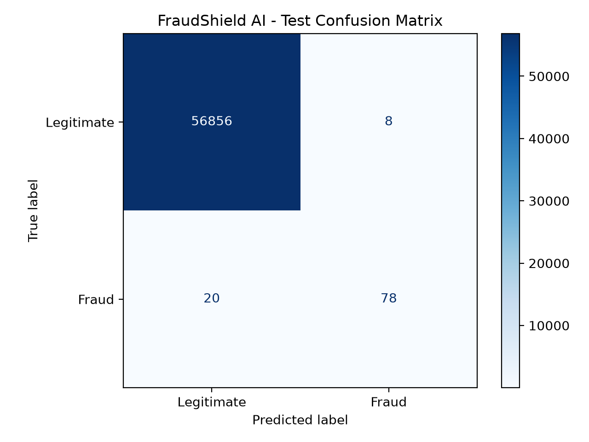
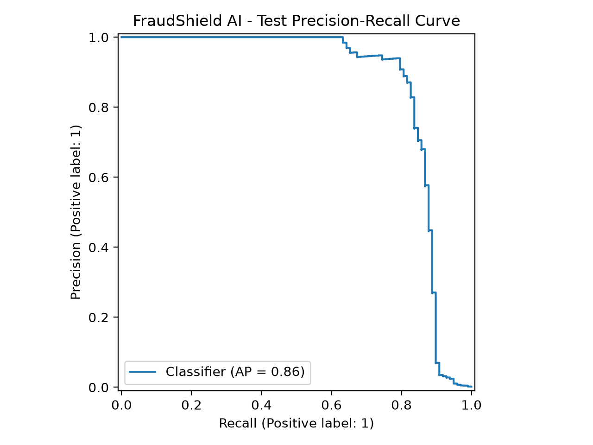
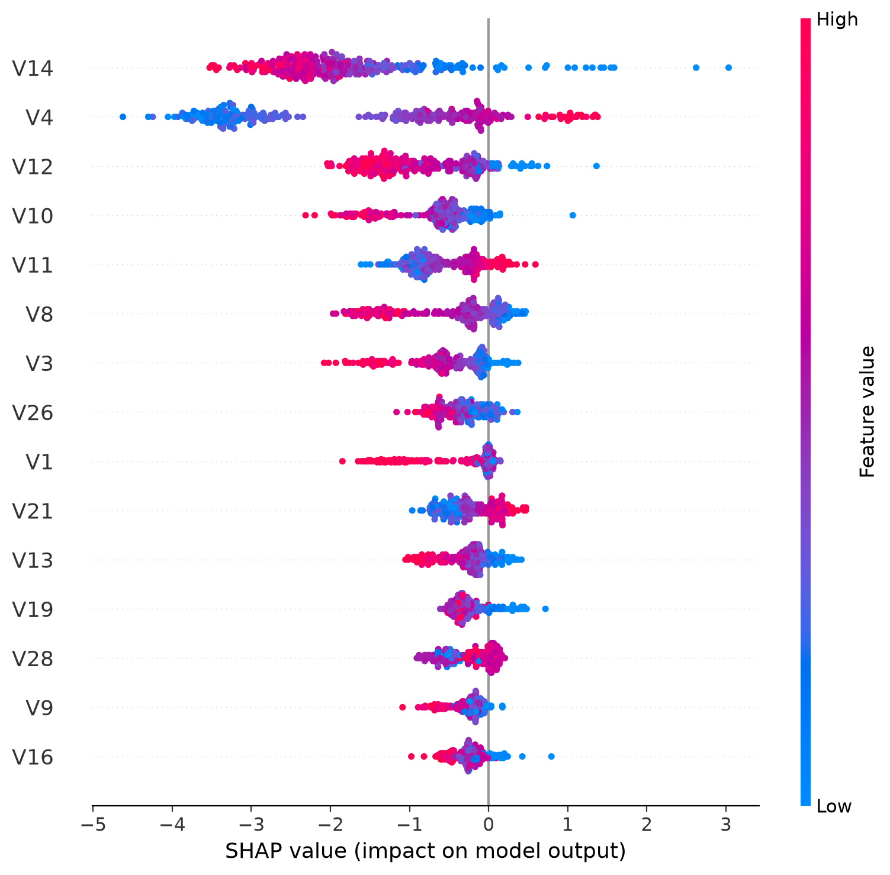

<p align="center"></p>

# ◈ FraudShield AI

### Financial Fraud Detection & Risk Intelligence

**Detect suspicious transactions · Compare machine-learning approaches · Explain model decisions**

An end-to-end, exploratory machine-learning application for detecting credit card fraud in highly imbalanced transaction data.

[Quick start](#-quick-start) · [Model results](#-model-results) · [Architecture](#-architecture--pipeline) · [Limitations](#️-limitations--responsible-use)

---

## 🛠️ Technology Stack

| Component | Technologies / Methods |
|---|---|
| Programming | Python 3.12 |
| Data processing | Pandas, NumPy |
| Supervised learning | Scikit-learn, XGBoost, Logistic Regression, Random Forest |
| Anomaly detection | Isolation Forest, TensorFlow / Keras Autoencoder |
| Model evaluation | Stratified splits, PR-AUC, ROC-AUC, precision, recall, F1, confusion matrix |
| Explainability | SHAP, global feature importance, transaction-level explanations |
| Dashboard | Streamlit, Plotly, Matplotlib |
| Testing | Pytest |
| Version control | Git, GitHub |

---

## 🎯 The Problem

Credit card fraud is rare relative to legitimate spending. In the dataset used here, **492 out of 284,807 transactions** are labeled fraudulent—approximately **0.173%**. A classifier that predicts every transaction as legitimate would appear highly accurate while detecting no fraud.

**FraudShield AI** investigates a more useful question: *Which modeling approaches can identify fraudulent transactions while keeping false alerts manageable?*

The project compares three supervised classifiers with two anomaly-detection approaches, selects an XGBoost model using validation results, and provides a Streamlit interface for exploring predictions and explanations.

**Scope:** Research and portfolio prototype, not a payment-processing system or a production fraud decision engine.

## 🖥️ Application Preview

The Streamlit dashboard includes four areas:

| Area | Capabilities |
|---|---|
| **Overview** | Transaction volume, class distribution, fraud prevalence |
| **Transaction Analysis** | Select a dataset transaction, inspect XGBoost fraud score and predicted label, compare with its recorded class |
| **Explainability** | Global SHAP feature importance and visualization; individual explanations where enabled |
| **Model Comparison** | Validation performance across five modeling approaches |

> **Screenshot:** Add a real screenshot of your running application to `assets/dashboard.png`, then replace this note with ``. Do not use an invented dashboard mockup as evidence of the running app.

---

## 🔁 Architecture & Pipeline

```text
Credit card transactions (creditcard.csv)
                  │
                  ▼
         Dataset validation
                  │
                  ▼
      Stratified data partition
        60% train / 20% validation / 20% test
                  │
          ┌───────┴─────────┐
          ▼                 ▼
  Supervised models    Anomaly detection
  • Logistic Reg.      • Isolation Forest
  • Random Forest      • Autoencoder
  • XGBoost            (normal training data)
          │                 │
          └────────┬────────┘
                   ▼
        Validation comparison
         PR-AUC + F1 / threshold
                   │
                   ▼
          Selected XGBoost
                   │
                   ▼
       Reserved test evaluation
                   │
          ┌────────┴────────┐
          ▼                 ▼
      SHAP analysis    Streamlit dashboard
```

**Training and evaluation:** The dataset is partitioned with stratified random sampling (`random_state=42`). Model comparisons use the validation partition. Thresholds for classification are chosen by maximizing validation F1, so threshold-dependent validation scores are optimistic. XGBoost was selected based on validation performance, and its chosen threshold was carried into the reported test evaluation without test-set retuning.

**Anomaly detection:** Isolation Forest and the autoencoder are trained using legitimate training transactions; they score how unusual a transaction appears. Their anomaly scores are not equivalent to calibrated fraud probabilities.

**Interpretability:** SHAP provides explanations for the fitted XGBoost model. The `V1`–`V28` variables are anonymized PCA components, so SHAP importance does **not** reveal the original real-world financial attributes.

---

## 📊 Model Results

### Validation comparison

| Model | PR-AUC | Precision | Recall | F1 |
|---|---:|---:|---:|---:|
| **XGBoost** | **0.8214** | **0.9390** | **0.7778** | **0.8508** |
| Random Forest | 0.7840 | 0.8652 | 0.7778 | 0.8191 |
| Logistic Regression | 0.6807 | 0.8256 | 0.7172 | 0.7676 |
| Autoencoder | 0.3016 | 0.3603 | 0.4949 | 0.4170 |
| Isolation Forest | 0.0883 | 0.1385 | 0.3232 | 0.1939 |

**Interpretation:** Supervised learning performed substantially better than anomaly detection on this labeled benchmark. Because fraud is rare, **PR-AUC** is emphasized over accuracy.

### Selected XGBoost — Test Evaluation

**Test set:** 56,962 transactions, including 98 fraud cases.  
**Decision threshold:** `0.919124` (selected on validation data).

| Metric | Test result |
|---|---:|
| **PR-AUC** | **0.8604** |
| ROC-AUC | 0.9785 |
| Precision | **0.9070** |
| Recall | **0.7959** |
| F1 | **0.8478** |

| Actual / Predicted | Legitimate | Fraud |
|---|---:|---:|
| **Legitimate** | 56,856 | 8 |
| **Fraud** | 20 | 78 |

The selected model **identified 78 of 98 fraud cases**, produced **8 false alerts**, and **missed 20 fraud cases** in this evaluation.





**Evaluation caveat:** An earlier exploratory Logistic Regression baseline inspected this same test partition. Thus, the partition was held out from the later XGBoost selection process, but it was **not completely untouched throughout the project**. These results are a benchmark, not an independent external validation or a guarantee of live performance.

---

## ✨ Explainable AI

FraudShield uses SHAP to investigate model behavior:

- **Global explanation:** Which anonymized variables most influence XGBoost outputs across sampled transactions.
- **Transaction-level explanation:** Which feature values move an individual prediction up or down, if the local SHAP view is enabled in the installed dashboard.
- **Important distinction:** SHAP explains model behavior, not causation. Depending on the explainer, contributions may be expressed in raw model-output units rather than probability percentage points.



---

## 🚀 Quick Start

### 1. Clone the project

```bash
git clone https://github.com/YoussefMouhi/FraudShield.git
cd FraudShield
```

### 2. Create a Python environment

Python **3.12** is recommended.

**macOS / Linux:**

```bash
python3.12 -m venv .venv
source .venv/bin/activate
python -m pip install -r requirements.txt
```

**Windows (PowerShell):**

```powershell
py -3.12 -m venv .venv
.venv\Scripts\python.exe -m pip install -r requirements.txt
```

> On some macOS systems, XGBoost may require the OpenMP runtime (`libomp`). TensorFlow installation also depends on platform compatibility.

### 3. Provide the dataset

Download the **Credit Card Fraud Detection** dataset from [Kaggle](https://www.kaggle.com/datasets/mlg-ulb/creditcardfraud) and save it as:

```text
data/creditcard.csv
```

The dataset is deliberately excluded from Git. It must be downloaded separately.

### 4. Run the dashboard

```bash
python -m streamlit run app.py
```

Open the local address shown by Streamlit (typically `http://localhost:8501`).

> The dashboard expects the trained XGBoost artifact and relevant analysis assets to be present under `models/` and `assets/`. If they are not committed to the repository, generate or supply them before launching the app.

### 5. Reproduce evaluation (optional)

Once the dataset and trained model are available:

```bash
python -m src.final_evaluation
python -m pytest tests/ -v
```

Other project scripts include `src.compare_models`, `src.anomaly_detection`, `src.autoencoder`, and `src.explainability`. Training and plotting can take additional time and may overwrite existing local artifacts.

---

## 📁 Repository Structure

```text
FraudShield/
├── app.py                         # Streamlit application
├── src/
│   ├── model_training.py          # Baseline model training
│   ├── compare_models.py          # Supervised model comparison
│   ├── anomaly_detection.py       # Isolation Forest
│   ├── autoencoder.py             # Neural anomaly detector
│   ├── explainability.py          # Global SHAP analysis
│   └── final_evaluation.py        # Selected XGBoost test metrics
├── models/
│   ├── xgboost_fraud_detector.joblib
│   ├── logistic_regression.joblib
│   ├── isolation_forest.joblib
│   ├── autoencoder.keras
│   ├── autoencoder_preprocessing.joblib
│   └── model_comparison.csv
├── assets/
│   ├── shap_summary.png
│   ├── shap_feature_importance.csv
│   ├── final_test_metrics.csv
│   ├── confusion_matrix.png
│   └── precision_recall_curve.png
├── tests/
│   └── test_fraudshield.py
├── data/                           # creditcard.csv (not tracked)
├── requirements.txt
├── .gitignore
└── README.md
```

*Structure reflects the project files developed locally; confirm each listed file is present before publishing.*

## 🧪 Tests

```bash
python -m pytest tests/ -v
```

The test suite is designed to verify model artifact structure, dataset schema, prediction ranges, and reproducibility of saved test metrics. These tests require local data and artifacts. Test success should be confirmed from an actual run rather than assumed.

---

## ⚠️ Limitations & Responsible Use

- **Prototype, not production-ready:** The model has not been evaluated in a real payment-processing environment.
- **Random rather than chronological split:** Temporal generalization, evolving fraud patterns, and concept drift remain untested.
- **Earlier test inspection:** An exploratory baseline previously examined the test partition, limiting claims of strict test-set independence.
- **Threshold selection:** The reported validation F1 values were measured on the same validation partition used to choose their thresholds.
- **Uncalibrated scores:** XGBoost output scores should not automatically be interpreted as calibrated real-world fraud probabilities.
- **Missed fraud:** The selected model missed 20 fraud cases in the reported test evaluation.
- **Explainability limits:** PCA-anonymized features restrict business interpretation; SHAP is not a causal explanation.
- **Fairness, privacy, and operations:** Any practical use requires authorized data access, security reviews, monitoring, human oversight, and independent validation. Do not use this prototype alone for consequential decisions about people.

## 🔭 Future Improvements

- Out-of-time evaluation and drift monitoring
- Cost-sensitive decision thresholds and probability calibration
- Cross-validation for more robust model selection
- Real-time inference API with input validation
- Experiment tracking and reproducible training pipeline
- Dashboard deployment and CI-based testing

---

## 👤 Author

**Youssef MOUHI**  
Computer Engineering · Data Science & Artificial Intelligence

**Project:** [FraudShield](https://github.com/YoussefMouhi/FraudShield)

---

*Built as a Data Science & AI portfolio project · FraudShield AI · 2026*
